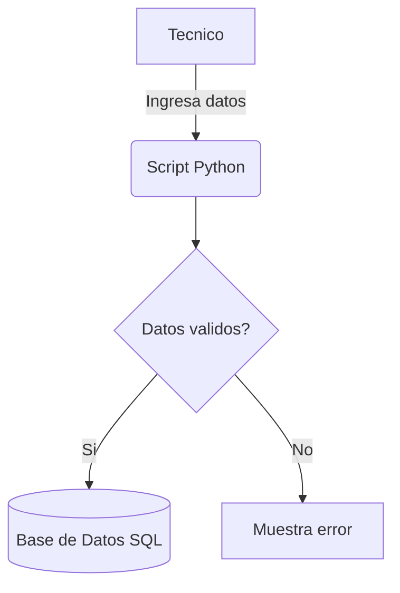

# Registro de Maquinaria Pesada


Sistema para el registro y monitoreo basico de maquinaria pesada en operaciones industriales y mineras.
Disenado para tecnicos y operadores que necesitan llevar un control rapido del mantenimiento.

## Tabla de contenidos
- [Instalacion](#instalacion)
- [Uso](#uso)
- [Estado de los modulos](#estado-de-los-modulos)
- [Hoja de ruta](#hoja-de-ruta)
- [Arquitectura](#arquitectura)
- [Contribucion](#contribucion)

## Instalacion
Clona el repositorio e instala las dependencias:
```bash
git clone [https://github.com/PieroRB-alt/registro-maquinaria.git](https://github.com/PieroRB-alt/registro-maquinaria.git)
cd registro-maquinaria
```

## Uso
Ejecuta el script principal para registrar una nueva maquina en la base de datos:
```python
import sqlite3

def registrar_maquina(nombre, tipo):
    conexion = sqlite3.connect('industria.db')
    cursor = conexion.cursor()
    cursor.execute("INSERT INTO maquinaria (nombre, tipo) VALUES (?, ?)", (nombre, tipo))
    conexion.commit()
    print(f"Maquina {nombre} registrada exitosamente.")
```

## Estado de los modulos
| Modulo | Estado | Prioridad |
|:---|:---:|---:|
| Registro BD | Listo | Alta |
| Interfaz Grafica | En curso | Media |
| Alertas por correo | Pendiente | Baja |

## Hoja de ruta
- [x] Crear esquema de base de datos
- [x] Script de registro manual
- [ ] Implementar lecturas de sensores
- [ ] Generar reportes PDF

## Arquitectura
Flujo de registro de datos:


## Contribucion
Lee la [guia de contribucion](CONTRIBUTING.md) antes de enviar cambios.